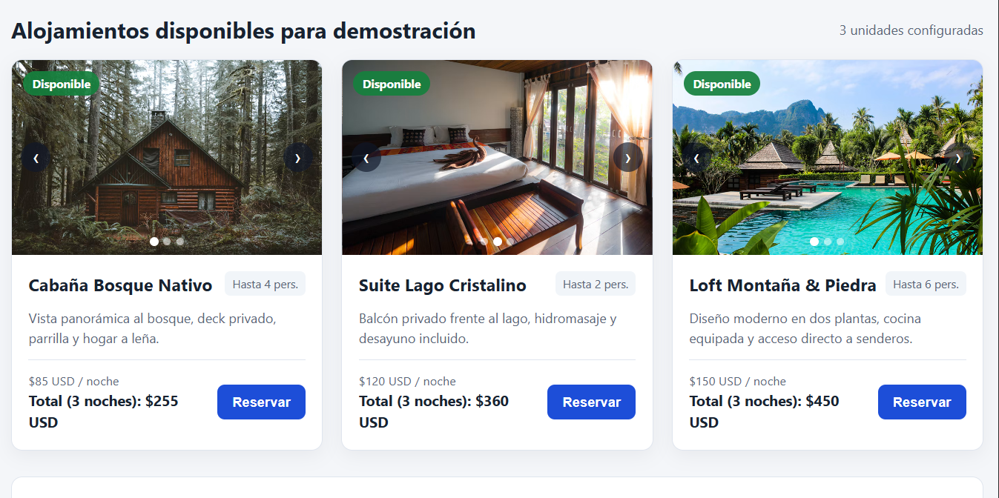

# Sistema de Reservas para Complejo de Cabañas

Aplicación web de reservas y control operativo para complejos de cabañas, con despliegue en Vercel y modo de demostración persistente en navegador.

- **Demo en vivo:** [https://hotel-reserva-mvp.vercel.app/](https://hotel-reserva-mvp.vercel.app/)
- **Captura de referencia:** `docs/frontend.png` (ruta en el repositorio: `hotel-reserva-mvp/docs/frontend.png`)



## Funcionalidades y reglas de negocio
- **Catálogo de cabañas:** 4 tipologías con categoría, capacidad máxima y tarifa por noche.
- **Control de disponibilidad:** validación de fechas (`check_in` / `check_out`), detección de solapamientos y filtro por cantidad de huéspedes.
- **Bloqueo temporal:** reserva transitoria de 15 minutos (`BLOQUEADA_TEMPORAL`) con contador regresivo y limpieza automática de bloqueos vencidos.
- **Esquema financiero:** cálculo automático de noches, total de estadía, seña del 30% (`PENDIENTE_SENA`) y saldo restante.
- **Gestión de estados y cierre:** administración de reservas confirmadas, pendientes de seña, cancelaciones/eliminaciones y generación de mensaje para WhatsApp.

## Arquitectura
- **Frontend:** React + Vite.
- **Capa de servicios:** `frontend/src/services/api.js` (intenta consumir `VITE_API_URL` y usa `localStorage` como respaldo de demostración).
- **Despliegue:** configurado para build de producción en Vercel.

## Ejecución local
```bash
cd frontend
npm install
npm run dev
